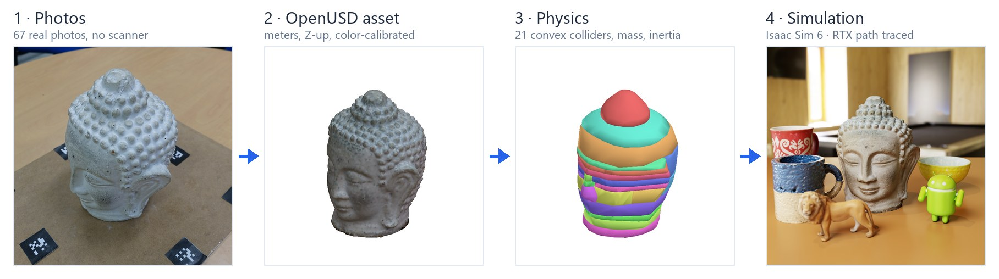
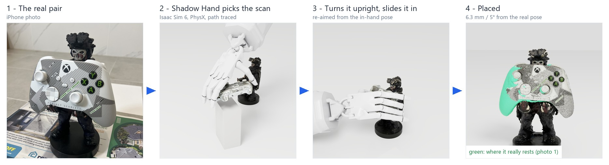
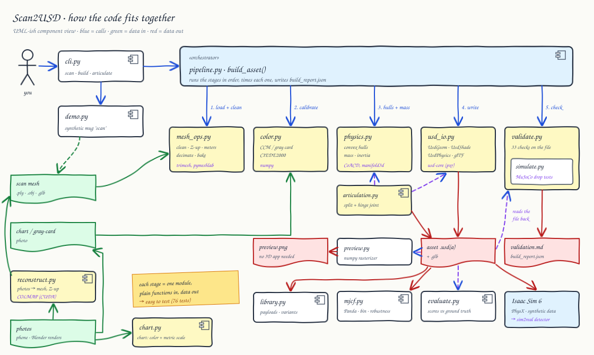
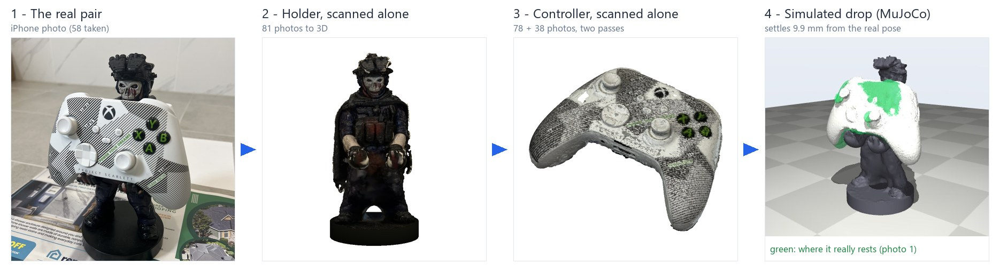
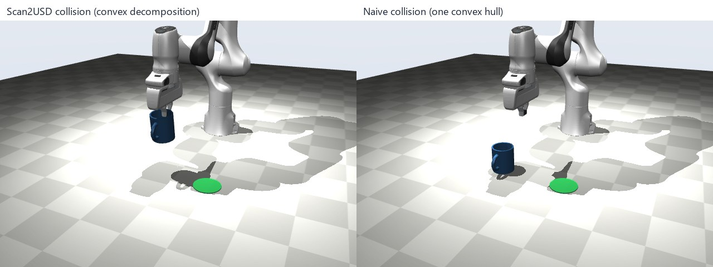
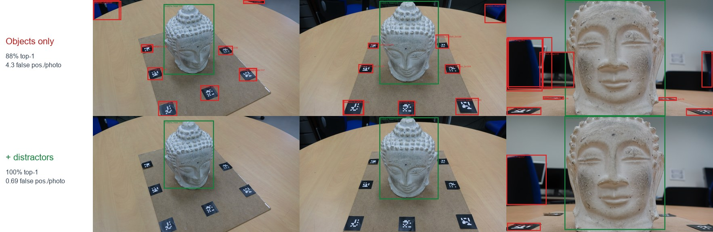
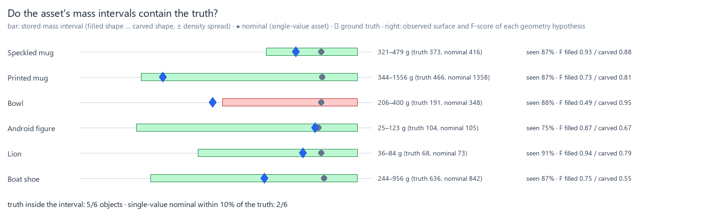
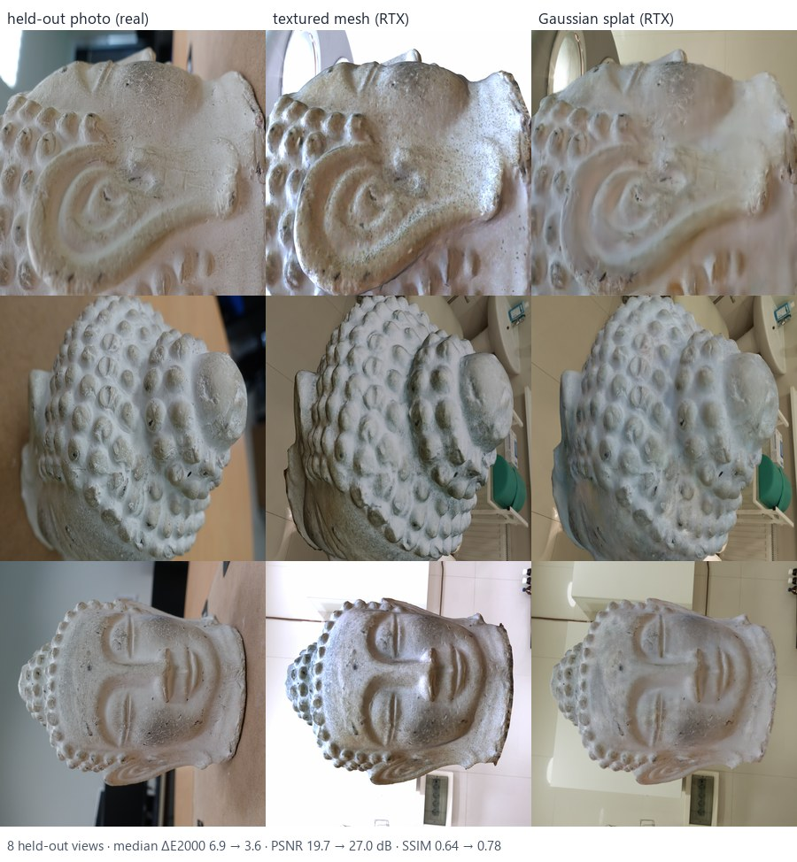
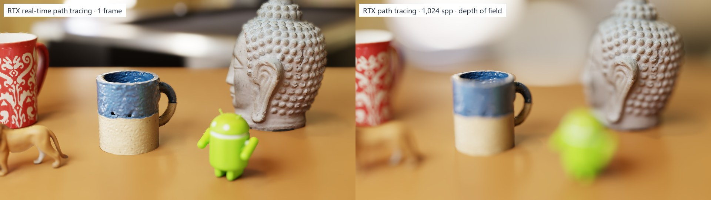
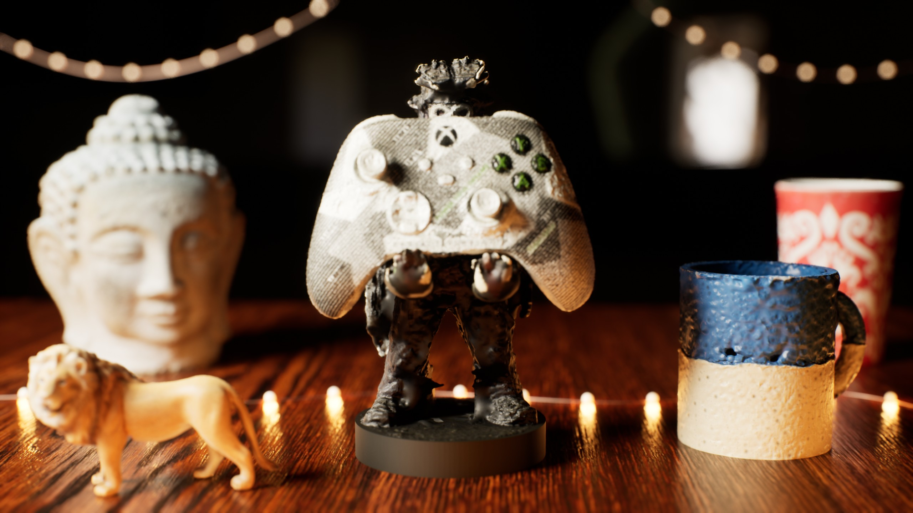

# Scan2USD

**Scan-to-Sim asset pipeline**: phone photos of everyday objects in, physics-ready **OpenUSD** assets out, verified in NVIDIA **Isaac Sim** and **MuJoCo**, and rendered in **Unreal Engine**.





- **Accurate:** 0.6–0.8 mm mean surface error on textured objects, scored against ground truth; size within 1.43% from a ColorChecker alone, no ruler.
- **Physics-ready:** convex decomposition, mass, inertia, articulated joints. A Franka Panda picks a scanned mug that a single convex hull makes unpickable.
- **Checked against reality:** from my own phone photos, a scanned controller settles into a scanned holder a median <!--n:sim_add-->9.1<!--/n--> mm from where the real one sits, and a Shadow Hand places it there in MuJoCo and Isaac Sim.
- **Useful for robot learning:** a detector trained only on Isaac Sim renders finds the object in **67/67** real photos and drives a see-locate-pick loop (10/10).
- **Assets that know what they don't know:** tested grasps, measurement uncertainty and a Gaussian-splat look stored in the USD file.

> Personal R&D project · Oct 2026 · **[Visual overview](https://visualknight.github.io/scan2usd/)** · **[<!--n:reel_s-->148<!--/n--> s demo video](https://visualknight.github.io/scan2usd/scan2usd_demo.mp4?v=28ba1843)** · **[Interactive 3D gallery](https://visualknight.github.io/scan2usd/gallery/)** · **[USD asset library](https://visualknight.github.io/scan2usd/library/)** · [benchmark](docs/benchmark.md)

## What it does



| Stage | What happens | Module |
|---|---|---|
| Reconstruct | COLMAP SfM + MVS; table plane → z = 0; object isolated; Poisson surface | `reconstruct.py` |
| Clean | Repair, meters / Z-up, decimation; texture and normal-map bake | `mesh_ops.py`, `bake.py` |
| Color | Color correction from a ColorChecker or gray card, found automatically | `color.py`, `chart.py` |
| Scale | Metric scale from the chart's patch spacing, no ruler (0.35–1.43% error) | `chart.py` |
| Physics | CoACD convex decomposition; mass, center of mass, inertia | `physics.py` |
| Articulation | Split a scan into parts joined by a USD revolute joint | `articulation.py` |
| Export | OpenUSD (geometry, PBR look, rigid body, colliders) and glTF | `usd_io.py` |
| Library | Many assets as payloads with `collision` and `friction` variant sets ([catalog](https://visualknight.github.io/scan2usd/library/)) | `library.py` |
| Grasps, uncertainty | Tested grasps and property intervals in codeless USD schemas | `schemas.py`, `uncertainty.py` |
| Capture guide | Which photos to take next | `guide.py` |
| Splat hybrid | A Gaussian splat for looks under the physics hulls | `splat.py` |
| Validate, evaluate | 33 checks on the written file; scoring against ground truth | `validate.py`, `evaluate.py` |
| Register, carve | Align scans up to scale; cut out space the photos see through | `register.py`, `carve.py` |

## Results

**Photos → USD, scored against ground truth.** 78-photo phone-style captures rendered in Blender, reconstructed with COLMAP. Full table: [docs/benchmark.md](docs/benchmark.md).

| Object | Accuracy mean / p95 (mm) | F-score @2 mm | Volume error | Chart ΔE2000 |
|---|---|---|---|---|
| Speckled stoneware mug (procedural) | 0.78 / 2.87 | 0.934 | +11.8% | 7.6 → 1.31 |
| Lion figure | 0.60 / 2.41 | 0.941 | +8.2% | 8.0 → 1.29 |
| Android figure toy | 0.78 / 3.08 | 0.872 | +1.4% | 7.7 → 1.38 |
| Boat shoe | 1.73 / 7.20 | 0.747 | +32.2% | 8.9 → 1.31 |
| Printed coffee mug | 2.00 / 10.20 | 0.731 | +191.5% | 8.0 → 1.30 |
| Ceramic bowl | 3.03 / 9.61 | 0.494 | +82.0% | 7.8 → 1.32 |

Surfaces no photo can match (a plain white interior, a bowl's underside) get sealed, so their volume is off; the asset records that as uncertainty, and a measured `--mass` keeps physics right.



**Real-world check: scan, simulate, compare.** I photographed a controller holder and a controller, each alone, then together; the combined scan is the answer key. Dropped into the scanned holder, the scanned controller settles <!--n:sim_held-->12/12<!--/n--> times, median **<!--n:sim_add-->9.1<!--/n--> mm / <!--n:sim_rot-->11<!--/n-->°** from where the real one sits ([MuJoCo](docs/figures/holder_fit.webp); [Isaac Sim PhysX](docs/figures/isaac_holder_fit.webp): <!--n:isaac_held-->11/12<!--/n-->, <!--n:isaac_add-->9.0<!--/n--> mm). With one convex hull for the holder it slides off (<!--n:hull_held-->0/12<!--/n-->). `scripts/study_holder_fit.py`

**Robots put it there.** A [Franka Panda](docs/figures/holder_place.webp) pinches the controller, turns it upright and seats it: <!--n:place_held-->12/12<!--/n--> held, <!--n:place_add-->4.7<!--/n--> mm / <!--n:place_rot-->8<!--/n-->° from the real pose. A [Shadow Hand](docs/figures/hand_place.webp) spans it at its center of mass instead: <!--n:hand_held-->12/12<!--/n--> at <!--n:hand_add-->6.4<!--/n--> mm / <!--n:hand_rot-->6<!--/n-->°, re-aimed from the in-hand pose. The same plan [in Isaac Sim PhysX](docs/figures/isaac_hand_place.mp4): <!--n:ihand_held-->12/12<!--/n--> at <!--n:ihand_add-->6.3<!--/n--> mm / <!--n:ihand_rot-->5<!--/n-->°, also [rendered in Unreal Engine 5.8](docs/figures/unreal_hand_place.mp4). The Panda's plans [in Isaac Sim PhysX](docs/figures/isaac_holder_place.webp): <!--n:iplace_held-->12/12<!--/n--> at <!--n:iplace_add-->7.2<!--/n--> mm / <!--n:iplace_rot-->9<!--/n-->°, once PhysX got the torsional friction MuJoCo's pads have. With one convex hull for the holder, every placement fails. `scripts/demo_holder_place.py`, `isaac_holder_place.py`, `demo_hand_place.py`, `isaac_hand_place.py`



**Why collision geometry matters** ([animation](docs/figures/panda_demo.webp)). A Franka Panda rim-grasps the scanned mug with one finger inside. With a single convex hull, that finger lands on a phantom lid and the pick fails. The [same plan in Isaac Sim](docs/figures/isaac_franka_pick.webp), from the grasp stored in the USD asset, places it within 5.5 mm, and fails the same way with one hull. `scripts/demo_panda.py`, `isaac_franka_pick.py`



**Sim-to-real perception.** A detector trained only on Isaac Sim renders of the scanned assets finds the object in **100%** of 67 real photos; unlabeled distractors in training cut false positives by 84%. It drives a [see-locate-pick loop](docs/figures/perception_pick.webp): 10/10 picks, 0.6 mm median pose error. `scripts/train_detector.py`



**Assets that know what they don't know.** Each vertex is labeled observed / inferred / sealed, and mass, scale and friction are stored as intervals: the true mass is inside for 5/6 objects. Tested grasps are stored too, and Isaac Sim's Franka picks with the best one. `scan2usd uncertainty`, `scan2usd grasps`



**Gaussian splat for looks, convex hulls for physics.** A splat trained on the same photos rides on the rigid body as a `UsdVol.ParticleField3DGaussianSplat`. On photos it never saw, it beats the textured mesh 18/18 (Buddha PSNR 19.7 → 27.0 dB), and it [falls on PhysX](docs/figures/splat_drop.mp4). `scan2usd splat`



**Path-traced look-dev.** PBR look presets and baked 2K albedo + normal maps, path traced in Isaac Sim 6 RTX. `scripts/isaac_pathtrace.py`



**The same USD files in Unreal Engine 5.8.** One USD stage with the scans and 80 shadow-casting fairy lights, imported as is. MegaLights renders it in <!--n:ue_on-->8.8<!--/n--> ms per frame vs <!--n:ue_off-->14.8<!--/n--> ms without, slightly closer to the path tracer ([comparison](docs/figures/unreal_megalights.jpg), [orbit](docs/figures/unreal_flythrough.mp4)). `scripts/unreal_render.py`

**More on the [overview page](https://visualknight.github.io/scan2usd/):** dexterous grasping, how accurate a scan must be, articulated assets, the asset library, color calibration, capture guidance, and lessons learned.

## Quickstart

Python 3.10–3.12, with [uv](https://docs.astral.sh/uv/):

```powershell
uv venv --python 3.11
uv pip install -e ".[dev]"
.venv\Scripts\scan2usd demo            # synthetic mug -> output\demo\ (see preview.png)
.venv\Scripts\python -m pytest         # 107 tests
```

Photo reconstruction needs [COLMAP](https://github.com/colmap/colmap/releases) (CUDA build): unzip it to `tools\colmap\` or set `SCAN2USD_COLMAP`.

## Usage

```powershell
# Photos -> USD in one step (reconstruct + build); --scale-to is the measured height
scan2usd scan photos\ -o output\mug --scale-to 0.095 --mass 0.36 --material ceramic `
    --chart-image chart.jpg --chart-corners "412,310;1630,322;1622,1140;405,1128"

# ColorChecker in some of the photos? Find it automatically for color, and get metric scale
# from its patch spacing (no ruler): pitch = center-to-center patch distance of your chart
scan2usd scan photos\ -o output\mug --material ceramic --chart-pitch-mm 16

# Or step by step: photos -> object mesh (Z-up, table at z=0, arbitrary scale)
scan2usd reconstruct photos\ -o work\mug

# Mesh -> simulation asset: scale from one ruler measurement, measured mass, color chart
scan2usd build work\mug\object_mesh.ply -o output\mug --scale-to 0.095 --scale-axis z --mass 0.36 `
    --material ceramic --chart-image chart.jpg --chart-corners "412,310;1630,322;1622,1140;405,1128"

# No ColorChecker? 18% gray card (or white paper with --gray-reflectance none)
scan2usd build mug.ply -o output\mug --gray-card-image card.jpg --gray-card-box "820,410,980,560"

# Hinged object: seam plane and hinge line in the asset frame (m, Z-up, origin at bottom center)
scan2usd articulate box.ply -o output\box --split "0,0,0.052,0,0,1" --hinge "0,0.05,0.052,-1,0,0" --limits 0,105

# Many assets -> one USD library: payloads + 'collision' and 'friction' variant sets
scan2usd library output\assets -o output\library\scan2usd_library.usda

# What the scan doesn't know: observation labels, carved hypothesis, property intervals -> into the USD
scan2usd uncertainty output\mug\mug.usda --workspace work\mug --material ceramic
scan2usd grasps output\mug\mug.usda                  # grasps stored by scripts/annotate_grasps.py
scan2usd guide output\mug\mug.usda --workspace work\mug -o shotlist   # which 8 photos to take next

# Hybrid look: mesh-masked dataset -> train a splat (Brush) -> splat under the rigid body
scan2usd splat-data output\mug\mug.usda --workspace work\mug -o work\mug_splat
brush_app work\mug_splat --total-steps 20000 --export-path work\mug_splat --export-name splat.ply
scan2usd splat output\mug\mug.usda work\mug_splat\splat.ply --workspace work\mug -o output\mug_hybrid

scan2usd preview output\mug\mug.usd    # PNG of render mesh + colliders, no 3D app needed
scan2usd validate output\mug\mug.usd --markdown report.md
scan2usd calibrate chart.jpg --chart-corners corners.json
scan2usd materials                     # density / friction presets
```

Chart corners are the outer corners of the 6×4 patch grid in pixels: top-left ("dark skin"), top-right, bottom-right, bottom-left.

Build outputs: `<name>.usd(a)`, `<name>.glb`, `textures/`, `color_calibration.json`, `validation.md`, `preview.png`, `build_report.json`.

## Scripts

Isaac Sim scripts (`isaac_*.py`) run with Isaac Sim 6's Python (`set OMNI_KIT_ACCEPT_EULA=YES`, then `<isaac-sim>\python.exe scripts\isaac_....py`); the rest use the project venv.

<details><summary>All scripts (benchmarks, demos, studies, figures)</summary>

| Script | Purpose |
|---|---|
| `make_synthetic_capture.py` | Render a phone-style capture of a ground-truth mesh in Blender (procedural mug or `--gso <model>`) |
| `evaluate_synthetic.py`, `run_benchmark.py` | Photos → COLMAP → Scan2USD → score against ground truth |
| `demo_panda.py` | Franka Panda (MuJoCo Menagerie) pick-and-place of a scanned mug; needs `git clone --depth 1 --filter=blob:none --sparse https://github.com/google-deepmind/mujoco_menagerie data\external\menagerie` then `git -C data\external\menagerie sparse-checkout set franka_emika_panda` |
| `demo_grasp.py`, `demo_clutter.py`, `demo_articulation.py` | MuJoCo robotics demos (animations in `docs/figures/`) |
| `demo_perception_pick.py` | Detect (synthetic-trained detector) → fit the scanned mesh to RGB-D → Panda picks at the estimated pose; needs `train_detector.py` output |
| `demo_holder_place.py` | Panda picks the scanned controller off a tray, turns it upright and places it into the scanned holder; scored against the real pose (decomposed vs one-hull holder); needs `study_holder_fit.py` output |
| `study_robustness.py` | Pick success vs. collision variant, friction, mass, scan size error and grasp error (93 MuJoCo trials in parallel, ~10 s) |
| `demo_hand_place.py` | Floating Shadow Hand spans the scanned controller, turns it upright and places it into the scanned holder; open loop vs re-aimed from the in-hand pose, decomposed vs one-hull holder; needs `study_holder_fit.py` output and the Menagerie Shadow Hand |
| `isaac_holder_place.py` | The Panda placement plans replayed in Isaac Sim 6 PhysX (MuJoCo finger pads with torsional friction added to Isaac's Franka, targets every substep); 12/12 placed |
| `isaac_hand_place.py` | The same placement in Isaac Sim 6 PhysX (hand via Isaac's MJCF importer, plans from `demo_hand_place.py --export-plans`); run with Isaac Sim's Python |
| `unreal_hand_render.py` | The MuJoCo placement rendered in Unreal Engine 5.8 (Lumen + MegaLights): USD stage of the hand meshes and scanned assets, per-frame tracks keyed in Sequencer, Movie Render Queue |
| `hand_motion.py` | Waypoints, blended minimum-jerk moves, the re-aim step and the camera cut, shared by the three engines above |
| `demo_hand_grasp.py` | Shadow Hand grasp sampling on the rigid benchmark assets (8 assets, 1,440 trials) (needs `git -C data\external\menagerie sparse-checkout add shadow_hand`) |
| `isaac_pathtrace.py`, `make_render_figures.py` | Isaac Sim 6 RTX path tracing: beauty shot, normal-map comparison, look-dev render from a photo's camera |
| `unreal_layout.py`, `unreal_render.py` | The tabletop as one USD stage, then Unreal Engine 5.8 (USD importer, Lumen, MegaLights, Movie Render Queue): hero still, MegaLights on/off vs path tracer, GPU timings, `--video` orbit; needs UE 5.6+ |
| `lookdev_camera.py`, `compare_lookdev.py` | Photo camera → USD camera in the asset frame; render-vs-photo silhouette and color metrics |
| `study_carving.py` | Visibility-carving experiment and cross-sections of the sealed benchmark objects |
| `isaac_library.py`, `make_catalog.py` | USD library in Isaac Sim (all collision variants in PhysX) and the web catalog `docs/library/` |
| `isaac_demo.py`, `make_isaac_figure.py` | Isaac Sim 6: PhysX settle test + Replicator dataset (run with Isaac Sim's Python) |
| `replicator_to_coco.py` | Replicator output → COCO (boxes from the bbox annotator, instance masks where they agree; multi-part assets merged per object) |
| `isaac_synthdata.py` | Isaac Sim 6: domain-randomized detection dataset (`--frames 1000 --distractors 12 --panels 5`) |
| `isaac_articulation.py` | Isaac Sim 6: drive the articulated asset's hinge, check tracking and the joint limit in PhysX |
| `export_panda_plan.py`, `isaac_franka_pick.py` | Plan the Panda pick once (MuJoCo IK, from the asset's best stored grasp), replay it on Isaac Sim's Franka with PhysX (sim-to-sim); `--splat` draws the mug with its Gaussian splat |
| `annotate_grasps.py` | Test grasps (Shadow Hand, Panda) on every library asset in MuJoCo and store them in the USD files |
| `study_uncertainty.py`, `study_robust_grasps.py` | Do the stored intervals contain the truth? Does randomizing within them predict real grasp success? |
| `isaac_holder_fit.py` | The holder drop-in test in Isaac Sim 6 PhysX (same assets, same releases) |
| `study_holder_fit.py` | Own phone captures: pen-box removal, two controller passes merged (`register.py`), assets at measured size and mass, both registered into the combined scan, MuJoCo drop-in vs the real pose |
| `sync_holder_numbers.py` | Writes the holder study's numbers into README.md and the overview from the result files (values sit between `<!--n:key-->` markers) |
| `study_capture_guide.py` | Weak capture + 8 guided / random / higher-ring photos rendered in Blender (`blender_render_capture.py --poses`), each reconstructed and scored |
| `isaac_splat.py`, `compare_splat.py` | Hybrid assets in Isaac Sim RTX: mesh vs splat from held-out photo cameras (scored against the photos), showcase, physics drop |
| `train_detector.py`, `make_coco_figure.py` | Train Faster R-CNN on the synthetic COCO set (needs `torch`/`torchvision`), score on held-out synthetic frames and on real photos |
| `blender_inspect.py` | Open a build in Blender: raw input, asset, colliders |
| `make_gallery.py` | Interactive web gallery (glTF + model-viewer) with a collision toggle → `docs/gallery/` |
| `make_hero.py` | The README hero strip: real photo → asset → colliders → Isaac Sim frame |
| `make_architecture.py` | The system diagram `docs/figures/architecture.svg` (four stages around the OpenUSD asset), and its interactive copy on the overview page: hover a box for operations, numbers and scripts |
| `make_hand_hero.py` | The second hero strip: the real pair → Shadow Hand grasp, insertion, result (Isaac Sim path-traced stills from `isaac_hand_place.py --stills`) |
| `make_sim2real_compare.py` | The sim-to-real figure: the same upright real photos through the detector trained without and with distractors |
| `make_demo_reel.py` | The demo video, assembled from the figures (`pip install "imageio[ffmpeg]"`) |

</details>

## Asset layout

```
/<name>                 Xform, kind=component, PhysicsRigidBodyAPI + PhysicsMassAPI
  Looks/M_surface       UsdPreviewSurface (texture, vertex colors or constant albedo)
  Looks/PM_contact      PhysicsMaterialAPI (friction, restitution)
  render                Mesh bound to M_surface
  collision/hull_###    Mesh, purpose=guide, CollisionAPI, MeshCollisionAPI(convexHull)
  grasps/g_###          Xform, purpose=guide, Scan2UsdGraspAPI (gripper, type, width, success rate, trials)
```

`scan2usd uncertainty` adds `Scan2UsdUncertaintyAPI` to the root (mass / scale / friction intervals, observed fraction, geometry hypotheses) and `primvars:scan2usd:observed` to the render mesh. A hybrid asset (`scan2usd splat`) is a thin layer that references the asset and adds `splat` (`ParticleField3DGaussianSplat`, payload), `shadow_proxy` and the `appearance` variant set.

Articulated assets put one such body per part under a root with `PhysicsArticulationRootAPI`, plus `joints/hinge` (`PhysicsRevoluteJoint`). Stage metadata: `upAxis = Z`, `metersPerUnit = 1`, `kilogramsPerUnit = 1`.

## Known limitations

- Plain, dark or glossy surfaces and deep textureless cavities don't reconstruct well (see the benchmark); a measured `--mass` corrects mass when the volume is off.
- Already-textured meshes (e.g. RealityScan exports) aren't decimated, since their UV layout would break; vertex-colored scans can be decimated and re-baked with `--bake-texture`.
- Part splitting for articulation is manual (plane + hinge line).
- Gaussian splats keep the lighting of the capture (they don't relight), render only in RTX real-time path tracing in Isaac Sim 6.0, and need an external trainer ([Brush](https://github.com/ArthurBrussee/brush) binary, no CUDA toolkit needed). With the shadow proxy, splats get somewhat darker where the proxy shadows them.

## Credits

Ground-truth meshes: [Google Scanned Objects](https://app.gazebosim.org/GoogleResearch/fuel/collections/Scanned%20Objects%20by%20Google%20Research) (CC-BY 4.0; the model id `Great_Dinos_Triceratops_Toy` contains an Android figure). Real photos: [AliceVision Buddha dataset](https://github.com/alicevision/dataset_buddha) (CC-BY 4.0). Robots: [MuJoCo Menagerie](https://github.com/google-deepmind/mujoco_menagerie) Franka Panda and Shadow Hand (Apache-2.0). Tools: COLMAP, CoACD, OpenUSD, MuJoCo, NVIDIA Isaac Sim, Blender, Brush (Gaussian splatting), OpenCV, trimesh, pymeshlab.

## License

Code: [Apache-2.0](LICENSE). Figures and gallery models derived from Google Scanned Objects and the AliceVision Buddha photos remain under CC-BY 4.0 with the attributions above.
