# Scan2USD

**Scan-to-Sim asset pipeline**: phone photos of everyday objects in, physics-ready **OpenUSD** assets out, verified in NVIDIA **Isaac Sim** and **MuJoCo**.


- **Accurate:** 0.6–0.8 mm mean surface error on textured objects, scored against ground-truth meshes; metric size within ±1.4% from a ColorChecker alone, no ruler.
- **Physics-ready:** convex decomposition, mass and inertia, articulated joints. A Franka Panda picks a scanned mug that it can't pick when the mug has a single convex hull.
- **Useful for robot learning:** a detector trained only on Isaac Sim renders of scanned assets finds the object in **100%** of 67 real photos, and drives a perception-to-grasp loop (10/10 picks).
- **Assets that know what they don't know:** grasps and measurement uncertainty stored in the USD file (codeless schemas), guidance on which photos to take next, and a **Gaussian-splat look riding on the physics hulls** that beats the textured mesh on 18/18 held-out photos.

> Personal R&D project · Oct 2026 · **[Visual overview](https://visualknight.github.io/scan2usd/)** · **[93 s demo video](https://visualknight.github.io/scan2usd/scan2usd_demo.mp4)** · **[Interactive 3D gallery](https://visualknight.github.io/scan2usd/gallery/)** (toggle collision hulls) · **[USD asset library](https://visualknight.github.io/scan2usd/library/)** · benchmark: [docs/benchmark.md](docs/benchmark.md)

## What it does


| Stage | What happens | Module |
|---|---|---|
| Reconstruct | COLMAP structure-from-motion + multi-view stereo; the table plane becomes z = 0 (Z-up); the object is isolated as the densest footprint above the table; screened Poisson surface; flat base | `reconstruct.py` |
| Clean | Debris removed, holes filled, meters / Z-up, origin at the base, topology-preserving decimation, optional texture bake (xatlas UV atlas, color transfer, island padding) and high-to-low tangent-space normal map bake | `mesh_ops.py`, `bake.py` |
| Color | 3×3 color-correction matrix from a ColorChecker (or gray card) applied to the albedo; CIEDE2000 reported. The chart is found automatically in the photos (OpenCV mcc) | `color.py`, `chart.py` |
| Scale | Metric scale without a ruler: the chart's patch centers are triangulated with COLMAP's camera poses (RANSAC over views) and compared with its physical patch pitch; **0.35–1.4% error** on the benchmark | `chart.py` |
| Physics | CoACD convex decomposition; mass, center of mass and principal inertia from volume × density or a measured mass; voxel-fill solids for scans with holes | `physics.py` |
| Articulation | Split a scan by a seam plane, one rigid body per part, `UsdPhysics.RevoluteJoint` with limits under an articulation root | `articulation.py` |
| Export | OpenUSD (`UsdGeom`, `UsdShade` preview surface with per-material PBR look presets (roughness, IOR, clearcoat for glazes, metallic) and normal maps, `UsdPhysics` rigid body / mass / colliders / physics material) and glTF | `usd_io.py` |
| Library | Many assets in one stage as payloads (load on demand), with `collision` (decomposed / convex_hull / bounding_box) and `friction` (measured / low / high) variant sets authored in the library layer; asset files untouched. [Catalog](https://visualknight.github.io/scan2usd/library/) | `library.py` |
| Grasps | Grasp poses with their tested success rate per gripper and collision variant, stored as `Scan2UsdGraspAPI` prims (codeless USD schema plugin) | `schemas.py` |
| Uncertainty | Per-vertex observation labels (observed / inferred / sealed), a "carved" geometry hypothesis for unseen cavities, and intervals for mass, scale and friction (`Scan2UsdUncertaintyAPI`); samplers for domain randomization | `uncertainty.py` |
| Capture guide | Which extra photos would see the physics-relevant surface no photo saw twice: a ranked shot list and a top-down map | `guide.py` |
| Splat hybrid | Mesh silhouettes as alpha masks for splat training; the trained Gaussian splat (`UsdVol.ParticleField3DGaussianSplat`) added under the rigid body with an `appearance` variant set (mesh / splat / splat + shadow proxy) | `splat.py` |
| Validate | 33 checks on the written file, including MuJoCo drop tests | `validate.py`, `simulate.py` |
| Evaluate | Accuracy / completeness / F-score / volume against ground truth after alignment | `evaluate.py` |

## Results

**Photos → USD, scored against ground truth.** Each object is a 78-photo phone-style capture rendered in Blender (with a ColorChecker in the scene), reconstructed with COLMAP, and built with one ruler measurement. Full table: [docs/benchmark.md](docs/benchmark.md).

| Object | Photos registered | Accuracy mean / p95 (mm) | Completeness mean (mm) | F-score @2 mm | F-score @2 mm, above base | Volume error | Chart ΔE2000 | Validation | Time (s) |
|---|---|---|---|---|---|---|---|---|---|
| Speckled stoneware mug (procedural) | 78/78 | 0.78 / 2.87 | 0.64 | 0.934 | 0.921 | +11.8% | 7.6 → 1.31 | warn | 315 |
| Printed coffee mug | 78/78 | 2.00 / 10.20 | 2.38 | 0.731 | 0.748 | +191.5% | 8.0 → 1.30 | pass | 684 |
| Ceramic bowl | 78/78 | 3.03 / 9.61 | 2.34 | 0.494 | 0.524 | +82.0% | 7.8 → 1.32 | warn | 891 |
| Android figure toy* | 78/78 | 0.78 / 3.08 | 0.96 | 0.872 | 0.894 | +1.4% | 7.7 → 1.38 | warn | 648 |
| Lion figure | 78/78 | 0.60 / 2.41 | 0.62 | 0.941 | 0.935 | +8.2% | 8.0 → 1.29 | pass | 552 |
| Boat shoe | 78/78 | 1.73 / 7.20 | 2.53 | 0.747 | 0.739 | +32.2% | 8.9 → 1.31 | pass | 627 |

*The GSO model id `Great_Dinos_Triceratops_Toy` contains an Android figure. "Above base" ignores the bottom 10 mm, which a tabletop capture can't see.

- **Textured objects** (figures, speckled glaze) reconstruct to 0.6–0.8 mm mean error, F-score 0.87–0.94, volume within 1–12%.
- **Printed mug:** its plain white interior is never matched, so the cup is sealed partway down (+191% volume).
- **Bowl:** its underside, between the foot and the rim's overhang, is never seen from above; Poisson fills it into a solid pedestal (see the cross-section below). The walls also come out ~2–3 mm thick in the stereo point cloud.
- **Shoe:** the opening and inside aren't observed and get sealed (+32%).
- **Visibility carving** (removing space that cameras saw through, using COLMAP's per-point visibility) only gets these to +175%, +74% and +29%: the sealed regions were never observed, so no line of sight proves them empty. The fix is in the capture: top-down shots into cavities, or flipping the object for a second pass. Meanwhile a measured `--mass` keeps physics right. `scripts/study_carving.py`

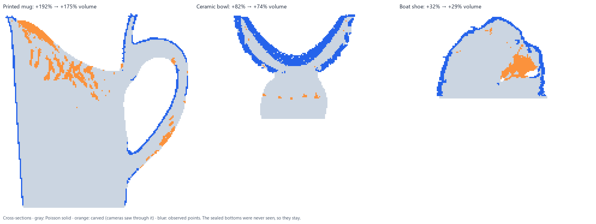

**How many photos?** On the lion figure: 12 photos fail (only 8 register, F-score 0.10); 20 give 0.80 mm / F 0.90; 39 give 0.61 mm; 78 give 0.60 mm / F 0.94. **Metric scale from the ColorChecker** (no ruler): 0.35–1.43% error across all six objects. Details in [docs/benchmark.md](docs/benchmark.md).

| | |
|---|---|
| 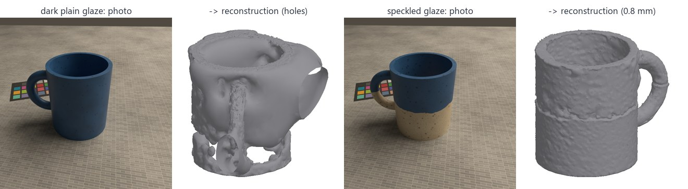 | Photogrammetry needs surface texture: the same mug with a plain dark glaze leaves holes; with a speckled glaze it reconstructs to 0.8 mm. |
| 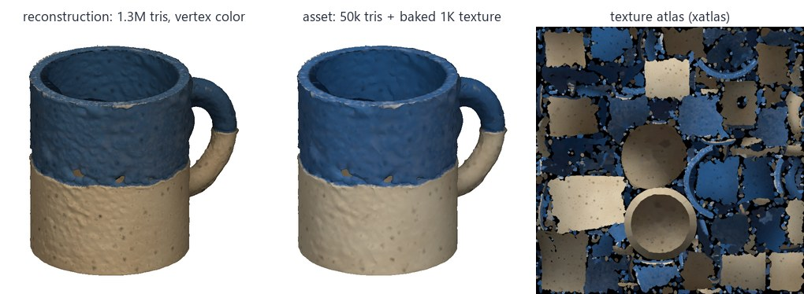 | **Texture baking** (`--bake-texture 1024`): the 1.3M-triangle vertex-colored reconstruction becomes a 50k-triangle mesh with an xatlas UV atlas and a baked texture, visually identical and 26× lighter. |
| 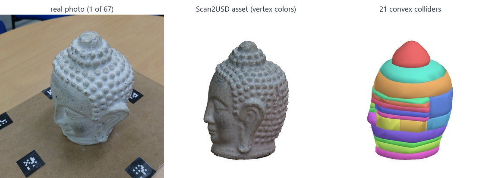 | **Real photos.** AliceVision's Buddha dataset (67 photos, CC-BY 4.0): all registered, marker board removed automatically, watertight head with 21 convex colliders (20 cm height assumed; the dataset gives no size). |

**Path-traced rendering** (Isaac Sim 6 RTX, `scripts/isaac_pathtrace.py`):

| | |
|---|---|
|  | **Scanned assets, path traced.** HDRI dome light (NVIDIA's `wooden_lounge` sky) plus an area key light, NVIDIA's MDL oak table, physically correct 50 mm f/5.6 depth of field (USD lens values are in tenths of a scene unit, so on a meters stage they're written as 0.05, not 50). Left: RTX real-time path tracing (one frame); right: offline path tracing (1,024 samples per pixel, AI denoiser, 6 bounces). [Full-size render](docs/figures/render_beauty.jpg) |
| 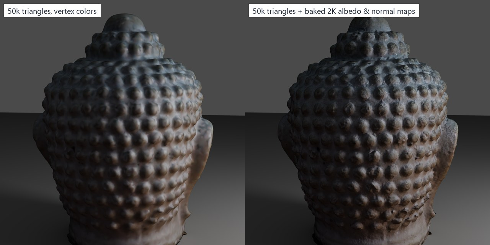 | **High-to-low normal map bake** (`--bake-texture 2048`). The 4.3M-triangle Buddha scan is decimated to 50k triangles, then its surface detail is baked into a tangent-space normal map (game-art workflow, with a cage-style test that ignores the far side of thin walls). Under grazing light, the right image recovers the chipped, porous stone. |
| 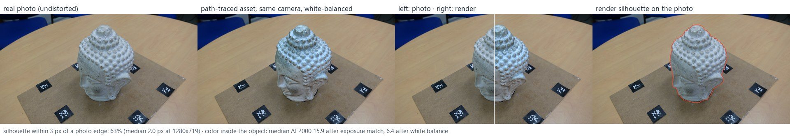 | **Look-dev against a real photo.** The asset is path traced from the photo's solved camera (COLMAP pose chained through the pipeline's table alignment and scaling). 63% of the render's silhouette lies within 3 px of a photo edge (median 2.0 px at 1280×719). That checks geometry, scale and camera together. After matching white balance, the color difference inside the object is median ΔE2000 6.4; the remainder is lighting and shadow, since the real room light is unknown. `scripts/lookdev_camera.py`, `scripts/compare_lookdev.py` |

**Robotics demos** (MuJoCo, and Isaac Sim 6 with PhysX + Replicator):

| | |
|---|---|
|  | **Franka Panda pick-and-place** ([animation](docs/figures/panda_demo.webp)). The MuJoCo Menagerie Panda rim-grasps the scanned mug (one finger inside the cup), lifts it 14 cm and places it 25 cm away (11 mm placement error). With a single convex hull the inner finger lands on a phantom "lid" and the pick fails. `scripts/demo_panda.py` |
| 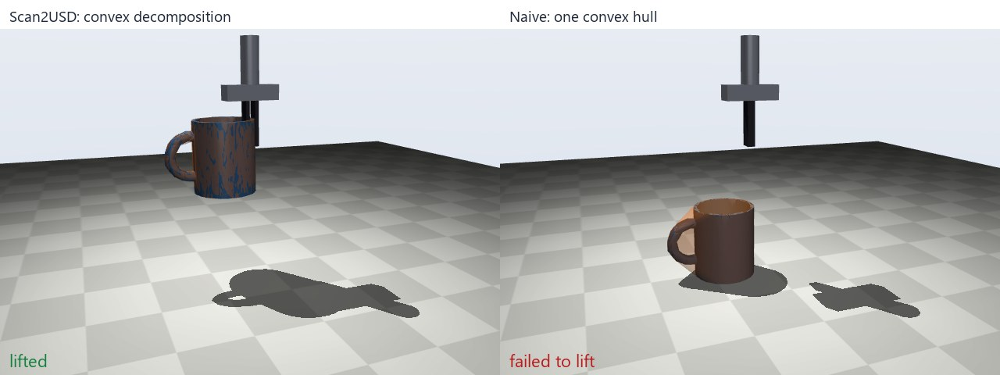 | **Rim grasp, minimal gripper.** Same comparison with a two-finger gripper: decomposition lifts the mug 11.6 cm, one hull lifts it 0 cm. `scripts/demo_grasp.py` |
| 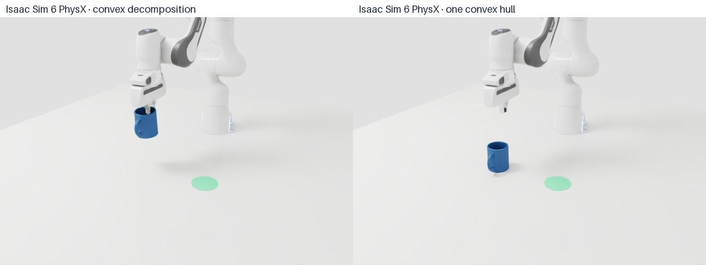 | **Same pick in Isaac Sim 6 (sim-to-sim)** ([animation](docs/figures/isaac_franka_pick.webp)). The joint plan from MuJoCo (now built from the asset's best stored grasp) replayed on NVIDIA's Franka with PhysX contacts, mug from the asset library. Decomposition: lifted 14.1 cm, placed with 5.5 mm error. The `convex_hull` variant fails the same way in both engines: the fingers land on the phantom lid 2.4 cm above the rim. Hand poses agree to 0.5 mm. `scripts/export_panda_plan.py`, `scripts/isaac_franka_pick.py` |
| 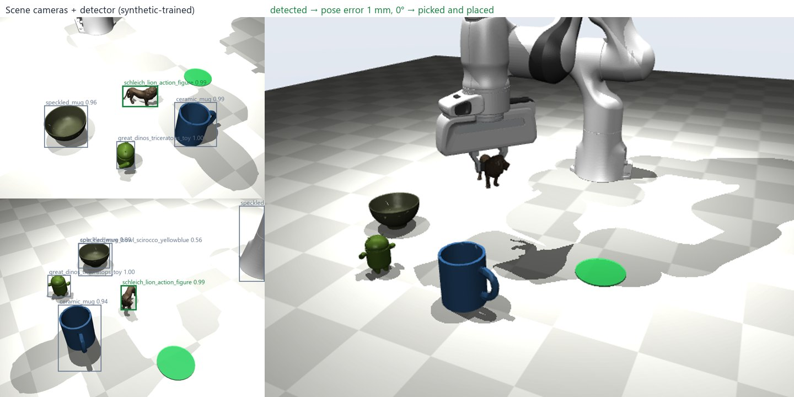 | **Perception in the loop** ([animation](docs/figures/perception_pick.webp)). The mug is dropped at a random pose among other scanned objects. Two scene cameras (RGB-D) → the synthetic-trained detector finds it → depth inside the box is fitted with the scanned mesh → the Panda picks at the *estimated* pose. **10/10 picks succeed**; median pose error 4.6 mm / 4.8°. In 3 trials the handle was hidden from both cameras, so yaw was unobservable (off by 44–149°), but the rim grasp doesn't need the handle. `scripts/demo_perception_pick.py` |
| 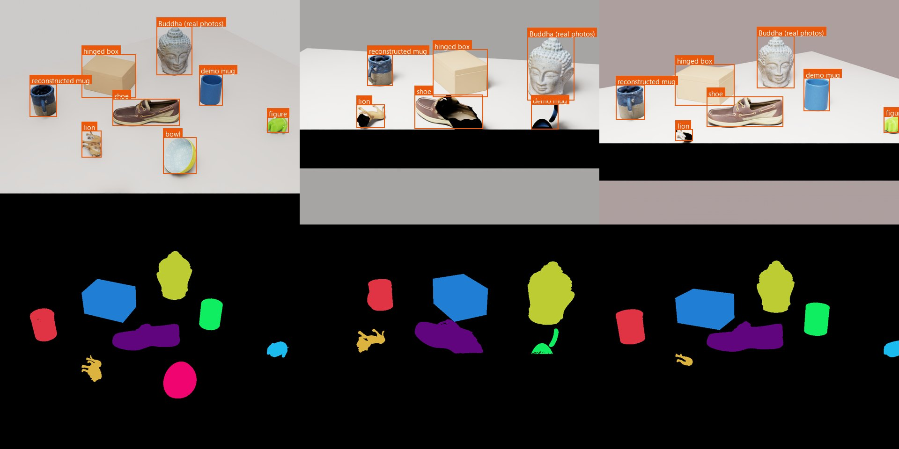 | **Isaac Sim 6.** 9 assets (incl. the real-photo Buddha) referenced unmodified, settled by PhysX, rendered by Replicator with random cameras and lights: RGB, tight 2D boxes, semantic + instance segmentation, depth; exported to COCO for detector training. `scripts/isaac_demo.py`, `scripts/replicator_to_coco.py` |
| 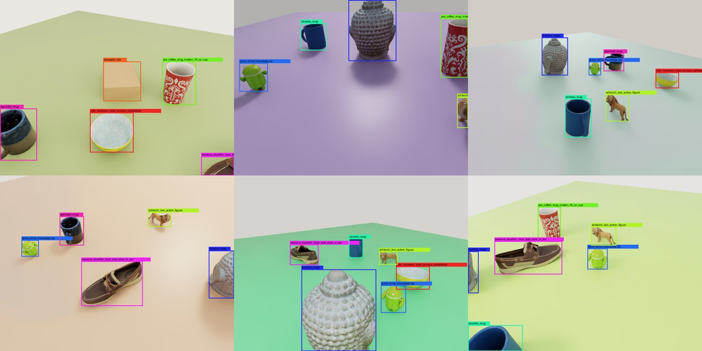 | **Domain-randomized training data.** Every frame re-samples which assets appear and where, table color, lights and camera, plus unlabeled distractors (primitives, flat "marker" cards, background panels). 1,000 labeled frames in ~3.5 min on one RTX 4090. `scripts/isaac_synthdata.py` |
|  | **Sim-to-real detection.** Faster R-CNN fine-tuned only on synthetic frames (900 images, 5.5 min), then run on the 67 real Buddha photos it never saw. Objects-only data: top detection is the Buddha in 88% of photos, but markers and lab clutter trigger 4.3 false detections per photo. Adding distractors: **100% top-1, 0.69 false positives per photo (−84%)**. `scripts/train_detector.py` |
| 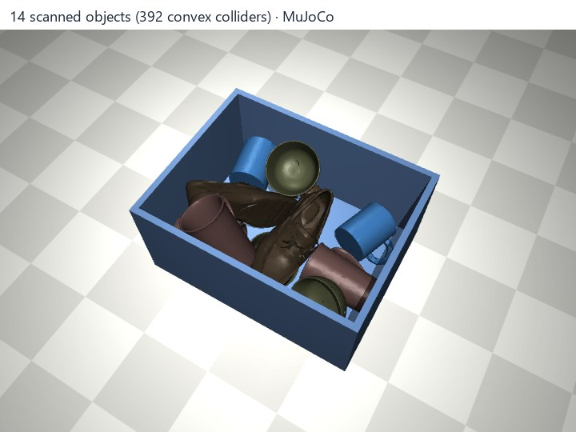 | **Bin of scanned objects.** 14 objects, 392 convex colliders; all settle in the tote, resting penetration 0.08 mm. `scripts/demo_clutter.py` |
| 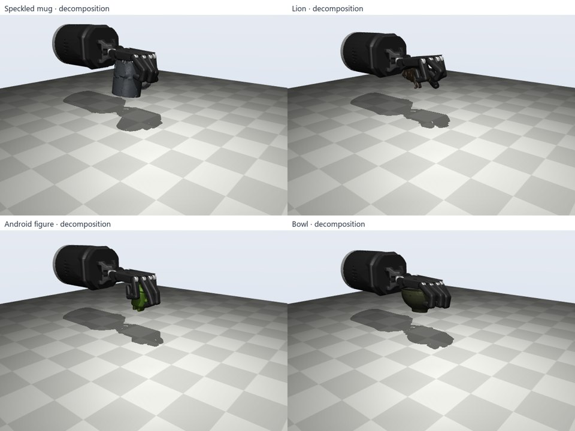 | **Dexterous grasping: Shadow Hand** ([animation](docs/figures/hand_grasp.webp), [per-asset rates](docs/figures/hand_grasp.png)). The 24-joint MuJoCo Menagerie hand tries 90 sampled power grasps per library asset and collision variant (1,440 trials, ~1 min): lift 15 cm, then a ±2 cm / 3 Hz shake. Convex decomposition: 23.5% of grasps hold on the six hand-sized objects, one convex hull: 18.9% (printed mug 30% vs 18%). The 4.6 kg Buddha and the 25 cm shoe are beyond the hand. `scripts/demo_hand_grasp.py` |
| 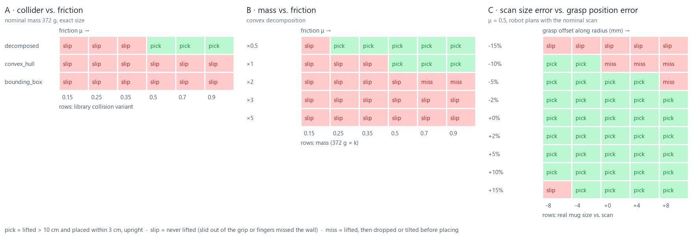 | **How accurate must a scan be?** 93 Panda picks where the simulated "real" mug differs from the scan the robot plans with. (A) Collision geometry decides it: with a single hull or bounding box (library variants) the pick fails at every friction; with the decomposition it works from μ ≈ 0.5. (B) Doubling the mass breaks the grip at any friction, so measured mass matters. (C) A size error within ±5% is tolerated, even with ±8 mm grasp error; the ColorChecker scale error (≤1.4%) is well inside that. A real object 10–15% smaller than its scan makes the fingers miss the rim. Gripper force here is ~9 N (a real Panda hand reaches 70 N). `scripts/study_robustness.py` |
| 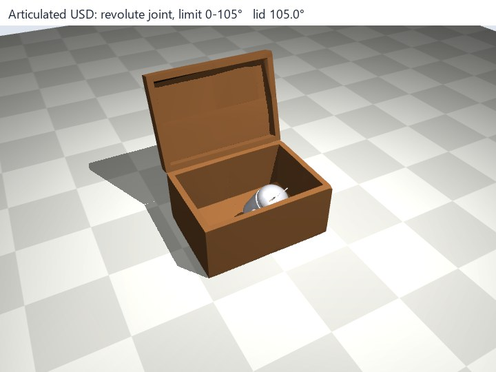 | **Articulated asset.** A closed box scan + seam plane + hinge line → base and lid with a revolute joint (0–105°); the lid opens, a scanned toy drops in, the lid closes. `scripts/demo_articulation.py` |
| 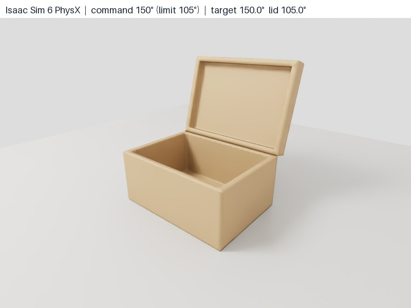 | **Same USD in Isaac Sim 6 PhysX** ([animation](docs/figures/isaac_articulation.webp)). Referenced unmodified; an angular drive on the hinge opens the lid to 90.1° (target 90°), holds at **105.0°** when commanded 150° (the asset's limit), closes to 0.0°; the base drifts 0.02 mm. `scripts/isaac_articulation.py` |

**Assets that know what they don't know.** A scan measures some things well, guesses others and misses some entirely. These assets carry that, plus how to hold them and how they really look, inside the USD file.

| | |
|---|---|
|  | **Uncertainty in the asset** (`scan2usd uncertainty`). Each vertex is labeled observed / inferred / sealed; mass, scale and friction are stored as intervals, and a carved geometry hypothesis empties cavities no camera saw into. The true mass falls inside the interval for 5/6 benchmark objects, while the single nominal value is within 10% for only 2/6 (the bowl misses: 206–400 g vs 191 g). Carving fixes the bowl (F-score 0.49 → 0.95) but hurts solid objects, so "filled" stays the default. `scripts/study_uncertainty.py` |
| 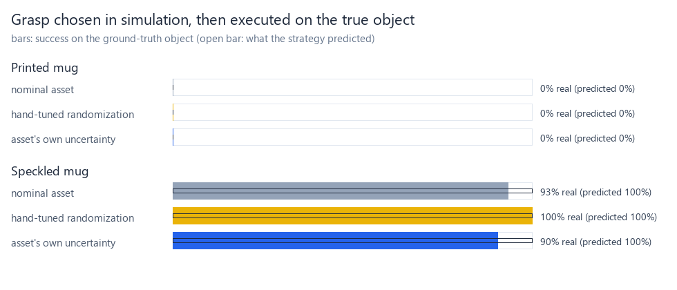 | **Randomize where the scan is unsure.** Grasps scored on physics sampled from the asset's own intervals predict success on the "real" object better than the nominal asset (Brier score 0.12 → 0.05, speckled mug). Hand-tuned ranges did as well, so the gain is grounded randomization, not this particular range. The printed mug can't be rim-grasped by the Panda even on its true shape. `scripts/study_robust_grasps.py` |
|  | **Grasps in USD** (`scan2usd grasps`). 756 MuJoCo trials write tested grasps (pose, gripper, success per collision variant) into every library asset as `Scan2UsdGraspAPI` prims. `export_panda_plan.py` plans from the best stored grasp. Isaac Sim recognizes the schema (`PXR_PLUGINPATH_NAME=src\scan2usd\schema`) and picks with 5.5 mm placement error; the `convex_hull` variant still fails. `scripts/annotate_grasps.py` |
| 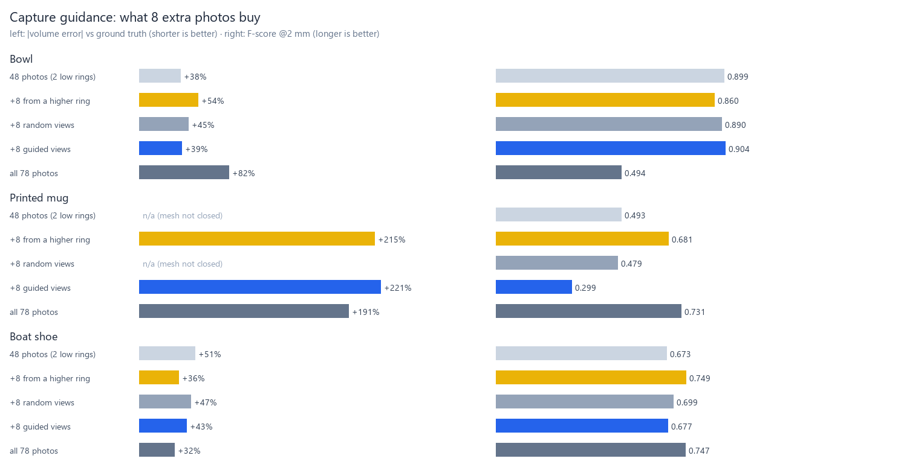 | **Capture guidance** (`scan2usd guide`). From a first capture: which surface matters for physics but wasn't seen by two photos, and which camera positions see most of it (an HTML shot list with a top-down map). Experiment: 48 photos, then 8 more rendered in Blender exactly where asked (camera fit ≤0.2 mm), vs 8 random and 8 higher-ring views. **Bowl:** guided wins (F-score 0.904 vs 0.890 / 0.860, sealed area 8.3% → 6.2%). **Shoe:** the higher ring wins (0.749 vs guided 0.677). **Printed mug:** guided is worst (0.30): it aimed straight into the plain white interior, which is visible but has no texture for stereo to match. So the guide needs a photometric term (texture), not just visibility. The experiment also exposed a meshing bug, now fixed: Poisson fragments were ranked by volume if closed and by area if open, so a large open sheet beat the mug. They're now ranked by how many of their vertices the point cloud supports. Single runs, so COLMAP noise is a few percent. `scripts/study_capture_guide.py` |
|  | **Hybrid asset: splat for looks, hulls for physics** (`scan2usd splat-data` → [Brush](https://github.com/ArthurBrussee/brush) → `scan2usd splat`). The mesh's silhouette, projected through every solved camera, becomes each photo's alpha, so the splat learns the object alone. The splat goes under the rigid body as a `UsdVol.ParticleField3DGaussianSplat`, carrying the build's reconstruction-to-asset transform. Rendered in Isaac Sim RTX from the cameras of photos it **never saw**, it beats the textured mesh on all of them. Buddha (8 real photos): ΔE2000 6.9 → 3.6, PSNR 19.7 → 27.0 dB, SSIM 0.64 → 0.78. Mug (10 synthetic): PSNR 17.1 → 28.9 dB ([figure](docs/figures/splat_mug.jpg)). Without the masks, the cropped mug splat is see-through (21.6 dB). Very close views are softer than the mesh. `scripts/isaac_splat.py`, `scripts/compare_splat.py` |
| 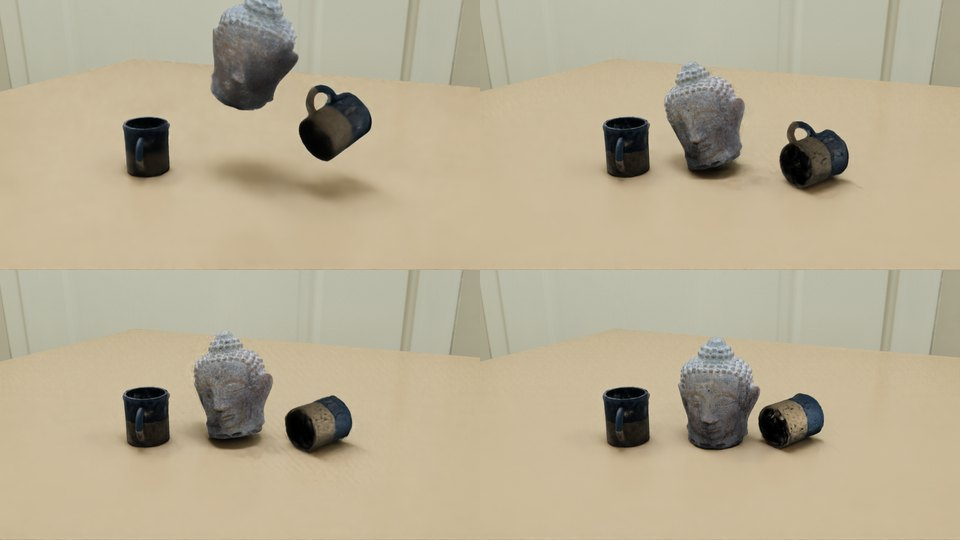 | **Splats ride on PhysX** ([video](docs/figures/splat_drop.mp4), [mesh / splat / proxy](docs/figures/splat_showcase.jpg)). Splat Buddha and mugs dropped onto a table. Splats carry baked lighting and cast no shadows, so the `splat_proxy` look adds an inset copy of the mesh that's hidden from the camera (`primvars:hideForCamera`) but casts shadows. Gaussians *receive* shadows in RTX, so a proxy at the surface turned them black; the inset is capped at half the local wall thickness for thin mugs. RTX real-time path tracing only: the offline path tracer renders splats dark. |
| 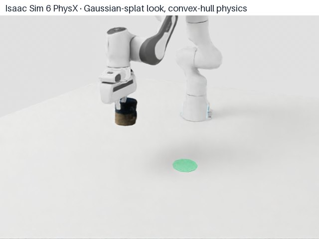 | **Franka picks a splat mug** ([animation](docs/figures/isaac_franka_pick_splat.webp)). Same plan and physics, the mug drawn by its splat: lifted 14.5 cm, placed 1.8 cm from the target. `isaac_franka_pick.py --splat ...` |

## Quickstart

Python 3.10–3.12, with [uv](https://docs.astral.sh/uv/):

```powershell
uv venv --python 3.11
uv pip install -e ".[dev]"
.venv\Scripts\scan2usd demo            # synthetic mug -> output\demo\ (see preview.png)
.venv\Scripts\python -m pytest         # 96 tests
```

Photo reconstruction needs [COLMAP](https://github.com/colmap/colmap/releases) (CUDA build): unzip it to `tools\colmap\` or set `SCAN2USD_COLMAP`.

## Usage

```powershell
# Photos -> USD in one step (reconstruct + build); --scale-to is the measured height
scan2usd scan photos\ -o output\mug --scale-to 0.095 --mass 0.36 --material ceramic `
    --chart-image chart.jpg --chart-corners "412,310;1630,322;1622,1140;405,1128"

# ColorChecker in some of the photos? Find it automatically for color, and get metric scale
# from its patch spacing (no ruler): pitch = center-to-center patch distance of your chart
scan2usd scan photos\ -o output\mug --material ceramic --chart-pitch-mm 16

# Or step by step: photos -> object mesh (Z-up, table at z=0, arbitrary scale)
scan2usd reconstruct photos\ -o work\mug

# Mesh -> simulation asset: scale from one ruler measurement, measured mass, color chart
scan2usd build work\mug\object_mesh.ply -o output\mug --scale-to 0.095 --scale-axis z --mass 0.36 `
    --material ceramic --chart-image chart.jpg --chart-corners "412,310;1630,322;1622,1140;405,1128"

# No ColorChecker? 18% gray card (or white paper with --gray-reflectance none)
scan2usd build mug.ply -o output\mug --gray-card-image card.jpg --gray-card-box "820,410,980,560"

# Hinged object: seam plane and hinge line in the asset frame (m, Z-up, origin at bottom center)
scan2usd articulate box.ply -o output\box --split "0,0,0.052,0,0,1" --hinge "0,0.05,0.052,-1,0,0" --limits 0,105

# Many assets -> one USD library: payloads + 'collision' and 'friction' variant sets
scan2usd library output\assets -o output\library\scan2usd_library.usda

# What the scan doesn't know: observation labels, carved hypothesis, property intervals -> into the USD
scan2usd uncertainty output\mug\mug.usda --workspace work\mug --material ceramic
scan2usd grasps output\mug\mug.usda                  # grasps stored by scripts/annotate_grasps.py
scan2usd guide output\mug\mug.usda --workspace work\mug -o shotlist   # which 8 photos to take next

# Hybrid look: mesh-masked dataset -> train a splat (Brush) -> splat under the rigid body
scan2usd splat-data output\mug\mug.usda --workspace work\mug -o work\mug_splat
brush_app work\mug_splat --total-steps 20000 --export-path work\mug_splat --export-name splat.ply
scan2usd splat output\mug\mug.usda work\mug_splat\splat.ply --workspace work\mug -o output\mug_hybrid

scan2usd preview output\mug\mug.usd    # PNG of render mesh + colliders, no 3D app needed
scan2usd validate output\mug\mug.usd --markdown report.md
scan2usd calibrate chart.jpg --chart-corners corners.json
scan2usd materials                     # density / friction presets
```

Chart corners are the outer corners of the 6×4 patch grid in pixels: top-left ("dark skin"), top-right, bottom-right, bottom-left.

Build outputs: `<name>.usd(a)`, `<name>.glb`, `textures/`, `color_calibration.json`, `validation.md`, `preview.png`, `build_report.json`.

## Scripts

| Script | Purpose |
|---|---|
| `make_synthetic_capture.py` | Render a phone-style capture of a ground-truth mesh in Blender (procedural mug or `--gso <model>`) |
| `evaluate_synthetic.py`, `run_benchmark.py` | Photos → COLMAP → Scan2USD → score against ground truth |
| `demo_panda.py` | Franka Panda (MuJoCo Menagerie) pick-and-place of a scanned mug; needs `git clone --depth 1 --filter=blob:none --sparse https://github.com/google-deepmind/mujoco_menagerie data\external\menagerie` then `git -C data\external\menagerie sparse-checkout set franka_emika_panda` |
| `demo_grasp.py`, `demo_clutter.py`, `demo_articulation.py` | MuJoCo robotics demos (animations in `docs/figures/`) |
| `demo_perception_pick.py` | Detect (synthetic-trained detector) → fit the scanned mesh to RGB-D → Panda picks at the estimated pose; needs `train_detector.py` output |
| `study_robustness.py` | Pick success vs. collision variant, friction, mass, scan size error and grasp error (93 MuJoCo trials in parallel, ~10 s) |
| `demo_hand_grasp.py` | Shadow Hand grasp sampling on every library asset (needs `git -C data\external\menagerie sparse-checkout add shadow_hand`) |
| `isaac_pathtrace.py`, `make_render_figures.py` | Isaac Sim 6 RTX path tracing: beauty shot, normal-map comparison, look-dev render from a photo's camera |
| `lookdev_camera.py`, `compare_lookdev.py` | Photo camera → USD camera in the asset frame; render-vs-photo silhouette and color metrics |
| `study_carving.py` | Visibility-carving experiment and cross-sections of the sealed benchmark objects |
| `isaac_library.py`, `make_catalog.py` | USD library in Isaac Sim (all collision variants in PhysX) and the web catalog `docs/library/` |
| `isaac_demo.py`, `make_isaac_figure.py` | Isaac Sim 6: PhysX settle test + Replicator dataset (run with Isaac Sim's Python) |
| `replicator_to_coco.py` | Replicator output → COCO (boxes from the bbox annotator, instance masks where they agree; multi-part assets merged per object) |
| `isaac_synthdata.py` | Isaac Sim 6: domain-randomized detection dataset (`--frames 1000 --distractors 12 --panels 5`) |
| `isaac_articulation.py` | Isaac Sim 6: drive the articulated asset's hinge, check tracking and the joint limit in PhysX |
| `export_panda_plan.py`, `isaac_franka_pick.py` | Plan the Panda pick once (MuJoCo IK, from the asset's best stored grasp), replay it on Isaac Sim's Franka with PhysX (sim-to-sim); `--splat` draws the mug with its Gaussian splat |
| `annotate_grasps.py` | Test grasps (Shadow Hand, Panda) on every library asset in MuJoCo and store them in the USD files |
| `study_uncertainty.py`, `study_robust_grasps.py` | Do the stored intervals contain the truth? Does randomizing within them predict real grasp success? |
| `study_capture_guide.py` | Weak capture + 8 guided / random / higher-ring photos rendered in Blender (`blender_render_capture.py --poses`), each reconstructed and scored |
| `isaac_splat.py`, `compare_splat.py` | Hybrid assets in Isaac Sim RTX: mesh vs splat from held-out photo cameras (scored against the photos), showcase, physics drop |
| `train_detector.py`, `make_coco_figure.py` | Train Faster R-CNN on the synthetic COCO set (needs `torch`/`torchvision`), score on held-out synthetic frames and on real photos |
| `blender_inspect.py` | Open a build in Blender: raw input, asset, colliders |
| `make_gallery.py` | Interactive web gallery (glTF + model-viewer) with a collision toggle → `docs/gallery/` |
| `make_hero.py` | The README hero strip: real photo → asset → colliders → Isaac Sim frame |
| `make_demo_reel.py` | The 93 s demo video from the figures (`pip install "imageio[ffmpeg]"`) |

## Asset layout

```
/<name>                 Xform, kind=component, PhysicsRigidBodyAPI + PhysicsMassAPI
  Looks/M_surface       UsdPreviewSurface (texture, vertex colors or constant albedo)
  Looks/PM_contact      PhysicsMaterialAPI (friction, restitution)
  render                Mesh bound to M_surface
  collision/hull_###    Mesh, purpose=guide, CollisionAPI, MeshCollisionAPI(convexHull)
  grasps/g_###          Xform, purpose=guide, Scan2UsdGraspAPI (gripper, type, width, success rate, trials)
```

`scan2usd uncertainty` adds `Scan2UsdUncertaintyAPI` to the root (mass / scale / friction intervals, observed fraction, geometry hypotheses) and `primvars:scan2usd:observed` to the render mesh. A hybrid asset (`scan2usd splat`) is a thin layer that references the asset and adds `splat` (`ParticleField3DGaussianSplat`, payload), `shadow_proxy` and the `appearance` variant set.

Articulated assets put one such body per part under a root with `PhysicsArticulationRootAPI`, plus `joints/hinge` (`PhysicsRevoluteJoint`). Stage metadata: `upAxis = Z`, `metersPerUnit = 1`, `kilogramsPerUnit = 1`.

## Known limitations

- Plain, dark or glossy surfaces and deep textureless cavities don't reconstruct well (see the benchmark); a measured `--mass` corrects mass when the volume is off.
- Already-textured meshes (e.g. RealityScan exports) aren't decimated, since their UV layout would break; vertex-colored scans can be decimated and re-baked with `--bake-texture`.
- Part splitting for articulation is manual (plane + hinge line).
- Gaussian splats keep the lighting of the capture (they don't relight), render only in RTX real-time path tracing in Isaac Sim 6.0, and need an external trainer ([Brush](https://github.com/ArthurBrussee/brush) binary, no CUDA toolkit needed). With the shadow proxy, splats get somewhat darker where the proxy shadows them.
- Windows with Smart App Control: `usd-core` warns that `pxr.Ts` (splines, unused) is blocked. Isaac Sim 5.1's RTX renderer crashed on driver 617; 6.0 works.

## Credits

Ground-truth meshes: [Google Scanned Objects](https://app.gazebosim.org/GoogleResearch/fuel/collections/Scanned%20Objects%20by%20Google%20Research) (CC-BY 4.0; the model id `Great_Dinos_Triceratops_Toy` contains an Android figure). Real photos: [AliceVision Buddha dataset](https://github.com/alicevision/dataset_buddha) (CC-BY 4.0). Robot: [MuJoCo Menagerie Franka Panda](https://github.com/google-deepmind/mujoco_menagerie/tree/main/franka_emika_panda) (Apache-2.0). Tools: COLMAP, CoACD, OpenUSD, MuJoCo, NVIDIA Isaac Sim, Blender, Brush (Gaussian splatting), OpenCV, trimesh, pymeshlab.

## License

Code: [Apache-2.0](LICENSE). Figures and gallery models derived from Google Scanned Objects and the AliceVision Buddha photos remain under CC-BY 4.0 with the attributions above.
